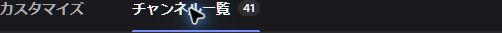
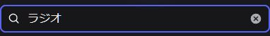
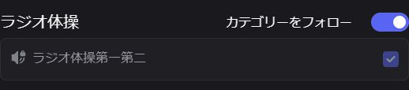

# PC版：体操チャンネルを一覧へ追加する

閲覧権限があっても、チャンネル一覧へ追加していないと見つけにくい場合があります。まずサーバー内の案内にある体操チャンネル/VCのリンクを使ってください。

1. サーバーの「チャンネル＆ロール」を開きます。

   

2. 「チャンネル一覧」タブを選びます。

   

3. 検索欄に「ラジオ」と入力します。

   

4. 「ラジオ体操」の「カテゴリーをフォロー」を確認します。表示されているVCから参加できます。

   

この画像はPCの実画面です。撮影時のアカウントは既にフォローONで、設定は変更していません。一般メンバーでOFFからONへ保存し、一覧へ反映する一連の動作は未検証です。表示が違う場合やカテゴリ自体が見つからない場合は、運営者に閲覧権限を確認してもらってください。自分のフォロー設定で閲覧権限を増やすことはできません。

一覧への追加、閲覧できること、開催時にVCへ接続できることは別の条件です。開催時間外の接続制限もあります。スマホ版の実画面手順はまだ準備していません。
